# Cafetería asíncrona

Una cafetería universitaria donde pides desde el teléfono y la respuesta llega de inmediato: "pedido recibido, número 11". Desde ahí la cocina trabaja por su cuenta y el pedido avanza solo por `recibido`, `preparando` y `listo`. Nadie se queda mirando la pantalla mientras le preparan el café; la página consulta el estado cada pocos segundos y te avisa cuando puedes ir a recogerlo.

Para lograrlo, el backend no le pide nada a la cocina directamente. Guarda el pedido en Firestore, deja un mensaje en un tema de Pub/Sub y responde. Pub/Sub le entrega ese mensaje a la cocina, un servicio privado en Cloud Run que nadie más puede llamar. La plantilla trae las tres aplicaciones completas y la infraestructura del frontend y el backend; tu grupo construye en Terraform todo lo que conecta al backend con la cocina.

| Pedir | Seguir el pedido | Pantalla de la cafetería |
|---|---|---|
|  |  |  |

Si el frontend no logra hablar con el backend, lo dice en vez de quedarse en blanco:


## Arquitectura al terminar la práctica

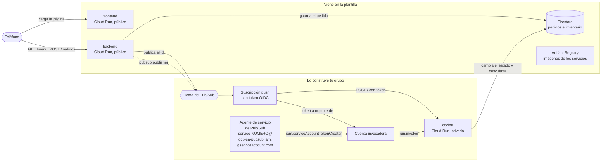

Las flechas punteadas son los permisos de IAM que da tu grupo. La etiqueta es el rol sin el prefijo `roles/` y la flecha llega al recurso sobre el que se da: el backend puede publicar solo en ese tema, el agente de Pub/Sub puede firmar tokens como la cuenta invocadora y esa cuenta puede invocar solo a la cocina.

En la plantilla, el backend ya sabe publicar, pero la variable `TEMA` está vacía: guarda el pedido, registra una advertencia y no avisa a nadie. Por eso, recién desplegada, la cafetería recibe pedidos que se quedan en `recibido` para siempre.

## Estructura del repositorio

```
backend/main.py            API en Flask: menú, pedidos, inventario y publicación en Pub/Sub
backend/requirements.txt   Dependencias del backend con versión fija
backend/Dockerfile         Imagen del backend con gunicorn
cocina/main.py             Worker que recibe las entregas push y prepara los pedidos
cocina/requirements.txt    Dependencias de la cocina con versión fija
cocina/Dockerfile          Imagen de la cocina con gunicorn
frontend/index.html        La página: vista para pedir y pantalla de la cafetería
frontend/server.py         Servidor sin dependencias que inyecta BACKEND_URL en la página
frontend/Dockerfile        Imagen del frontend
infra/providers.tf         Versión de Terraform y del proveedor de Google
infra/variables.tf         Proyecto, prefijo, región e imágenes
infra/main.tf              APIs, registro, Firestore, backend y frontend con sus cuentas
infra/outputs.tf           Ruta del registro y URL de los servicios
infra/terraform.tfvars.example   Ejemplo de valores; cópialo como terraform.tfvars
docs/api.md                Endpoints del backend y formato del mensaje de Pub/Sub
docs/estados.md            Ciclo de vida de un pedido y quién hace cada cambio
docs/capturas/             Capturas de la aplicación usadas en este README
.gitignore                 Deja por fuera el estado de Terraform, tus tfvars y __pycache__
```

## Cómo empezar

### Flujo de trabajo

1. Crea el repositorio de tu grupo con **Use this template** en GitHub.
2. Edita en VS Code o en github.dev (tecla `.` en la página del repositorio).
3. Haz commit y push desde el editor.
4. En Cloud Shell clonas la primera vez y traes los cambios con `git pull` después. Desde Cloud Shell nunca haces push.
5. Docker y Terraform se ejecutan siempre en Cloud Shell. La consola de Google Cloud es para mirar y diagnosticar, no para crear recursos.

### Primer despliegue

En Cloud Shell:

```bash
git clone https://github.com/<tu-usuario>/<tu-repositorio>.git
cd <tu-repositorio>/infra
cp terraform.tfvars.example terraform.tfvars
cloudshell edit terraform.tfvars
```

En `terraform.tfvars` pon el ID de tu proyecto y el prefijo del grupo, y ajusta las rutas de las imágenes a esos mismos valores. Este archivo vive solo en Cloud Shell: el `.gitignore` evita que llegue a GitHub.

El orden importa, porque las imágenes necesitan el registro y los servicios necesitan las imágenes:

```bash
# 1. Solo el registro (y las APIs de las que depende)
terraform init
terraform apply -target=google_artifact_registry_repository.registro

# 2. Las imágenes
REGISTRO=$(terraform output -raw registro)
gcloud auth configure-docker us-central1-docker.pkg.dev --quiet
cd ..
docker build -t $REGISTRO/backend:v1 backend
docker push $REGISTRO/backend:v1
docker build -t $REGISTRO/frontend:v1 frontend
docker push $REGISTRO/frontend:v1

# 3. Todo lo demás
cd infra
terraform apply
terraform output
```

Abre `url_frontend` en el teléfono. Si usas otra región, cambia `us-central1` en el comando de `gcloud auth configure-docker`.

Cuando cambies el código de un servicio, construye y sube la imagen con una etiqueta nueva (`v2`, `v3`...), actualízala en `terraform.tfvars` y vuelve a aplicar. Si subes otra vez la misma etiqueta, Terraform no ve ningún cambio y Cloud Run sigue con la versión anterior.

## Probar cada servicio con `docker run`

Antes de subir una imagen, pruébala en Cloud Shell. Para ver una página servida en Cloud Shell usa **Vista previa en la Web** y elige el puerto.

**Frontend.** No necesita credenciales:

```bash
docker run --rm -p 8080:8080 -e BACKEND_URL=https://<url-del-backend> $REGISTRO/frontend:v1
```

Abre la vista previa en el puerto 8080. Si no pasas `BACKEND_URL`, verás el mensaje de error de la captura de arriba.

**Backend sin Firestore.** El contenedor arranca aunque no tenga credenciales; la validación de pedidos no toca la base, así que puedes comprobarla:

```bash
docker run --rm -d --name backend -p 8081:8080 $REGISTRO/backend:v1
curl -i -X POST localhost:8081/pedidos -H 'Content-Type: application/json' -d '{"cliente": "Ana", "items": []}'
docker logs backend
docker rm -f backend
```

Debe responder `400` con el error en JSON.

**Backend con Firestore.** Cuando la base ya existe (después del primer `terraform apply` completo), puedes darle al contenedor tus propias credenciales:

```bash
gcloud auth application-default login
docker run --rm -d --name backend -p 8081:8080 \
  -e GOOGLE_CLOUD_PROJECT=<tu-proyecto> \
  -e BASE_DATOS=<prefijo>-cafeteria \
  -e GOOGLE_APPLICATION_CREDENTIALS=/adc.json \
  -v $HOME/.config/gcloud/application_default_credentials.json:/adc.json:ro \
  $REGISTRO/backend:v1
curl localhost:8081/menu
curl -X POST localhost:8081/pedidos -H 'Content-Type: application/json' \
  -d '{"cliente": "Ana", "items": [{"producto": "tinto", "cantidad": 1}]}'
```

**Cocina.** Escucha en `/` el mismo sobre que le entregaría Pub/Sub. Con las mismas credenciales, puedes hacerte pasar por Pub/Sub y entregarle a mano un pedido que esté en `recibido`:

```bash
docker build -t cocina cocina
docker run --rm -d --name cocina -p 8082:8080 \
  -e GOOGLE_CLOUD_PROJECT=<tu-proyecto> \
  -e BASE_DATOS=<prefijo>-cafeteria \
  -e GOOGLE_APPLICATION_CREDENTIALS=/adc.json \
  -v $HOME/.config/gcloud/application_default_credentials.json:/adc.json:ro \
  cocina
ID=<id de un pedido en recibido>
curl -i -X POST localhost:8082/ -H 'Content-Type: application/json' \
  -d "{\"message\": {\"data\": \"$(printf %s "$ID" | base64)\"}, \"deliveryAttempt\": 1}"
docker logs cocina
```

Responde `204` cuando termina, unos segundos después. Mira el pedido en la pantalla de la cafetería: acabas de hacer a mano lo que Pub/Sub va a hacer solo.

La cocina tiene dos variables para provocar fallas: `TIEMPO_PREPARACION` (segundos que tarda, 6 por defecto) y `PROBABILIDAD_FALLO` (entre 0 y 1; con esa probabilidad responde `500` después de haber terminado el trabajo). Los detalles están en [docs/api.md](docs/api.md) y el recorrido de un pedido en [docs/estados.md](docs/estados.md).

El plato misterioso falla siempre, y sin un tema de mensajes muertos Pub/Sub lo sigue reintentando mientras retenga el mensaje, que por defecto son 7 días. Cada intento deja un error en los logs de la cocina, así que se van a llenar hasta que tu grupo resuelva esa parte del reto.

---

# Informe del grupo

## Integrantes

| Nombre | Código | Usuario de GitHub |
|---|---|---|
| Luisangel Ferizzola Roa | 1152409 | LouisFzz |
| Beymar Jefrey Villamizar Estevez | 1152426 | Beymarjefreyve |
| Angel Johany Vesga Sarmiento | 1152381 | angelvesga |

Desplegamos con el proyecto de Google Cloud de Beymar, `project-3111890e-6ba4-4e0e-95f` (número `421977311923`), con el prefijo `beyluan` y la región `us-central1`.

## URL de la cafetería

Frontend: https://beyluan-frontend-ivd2fmc7ia-uc.a.run.app

Backend: https://beyluan-backend-ivd2fmc7ia-uc.a.run.app

Cocina (privada): https://beyluan-cocina-ivd2fmc7ia-uc.a.run.app

Después de terminar las pruebas y la reproducción desde cero, apagamos todo con `terraform destroy` (28 recursos destruidos) y borramos el bucket de preparación de Cloud Build, para que el proyecto no siguiera generando costos. Por eso las URL ya no responden.

## Diagrama propio

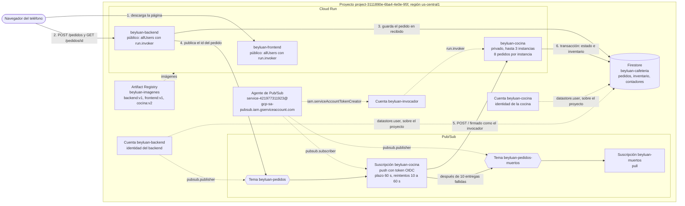

Las flechas punteadas con un rol son los permisos de IAM, cada una apuntando al recurso sobre el que se dio. Los de la fase 2 son `pubsub.publisher` del backend sobre el tema; los de la fase 3, `datastore.user` de la cocina, `run.invoker` del invocador sobre la cocina y `iam.serviceAccountTokenCreator` del agente de Pub/Sub sobre el invocador; los dos últimos del agente son del reto. La cocina no tiene ningún `run.invoker` para `allUsers`, y eso es lo que la hace privada.

El camino de un pedido, según el código:

1. El teléfono descarga la página del frontend. `server.py` solo escribe `BACKEND_URL` dentro del HTML.
2. El JavaScript de la página manda `POST /pedidos` al backend y después consulta `GET /pedidos/<id>` cada pocos segundos.
3. El backend valida el pedido, saca el número con un incremento atómico en `contadores/pedidos` y guarda el documento en `pedidos` con estado `recibido`.
4. Publica en `beyluan-pedidos` solo el id del documento, espera la confirmación de Pub/Sub y responde `201`.
5. La suscripción `beyluan-cocina` le hace un `POST /` a la cocina con un token OIDC a nombre de `beyluan-invocador`. Cloud Run revisa el token antes de dejar pasar la petición.
6. La cocina marca el pedido como `preparando`, espera 6 segundos y, en una transacción de Firestore, revisa el estado y las existencias, descuenta y lo deja en `listo` o `rechazado`. Responde `204` y Pub/Sub da el mensaje por entregado. Si la cocina falla 10 veces con el mismo mensaje, Pub/Sub lo pasa a `beyluan-pedidos-muertos`.

## Evidencias por fase

Las horas de las salidas de `gcloud` están en UTC. La consola de Google Cloud y el teléfono muestran la hora de Colombia (UTC-5), así que las 14:04 del teléfono son las 19:04 de los registros.

### Fase 0: repositorio, proyecto y configuración

Louis creó el repositorio público `LouisFzz/practica-05-Nube` desde la plantilla y agregó a Beymar y a Angel como colaboradores; en la página Contributors aparecemos los tres con commits. Desplegamos con el proyecto de Beymar, así que todos los comandos de Docker, Cloud Build y Terraform se corrieron en su Cloud Shell. El código lo editamos en VS Code y lo subimos con push; en Cloud Shell solo hicimos `git clone` y `git pull`.

Usamos otra vez el prefijo `beyluan`, el mismo de la práctica 6. Antes de aplicar comprobamos que no quedaban recursos de esa práctica en el proyecto: `gcloud run services list`, `gcloud artifacts repositories list` y `gcloud firestore databases list` respondieron `Listed 0 items`, así que no había nombres que chocaran. Terraform estaba en la versión 1.16.2.

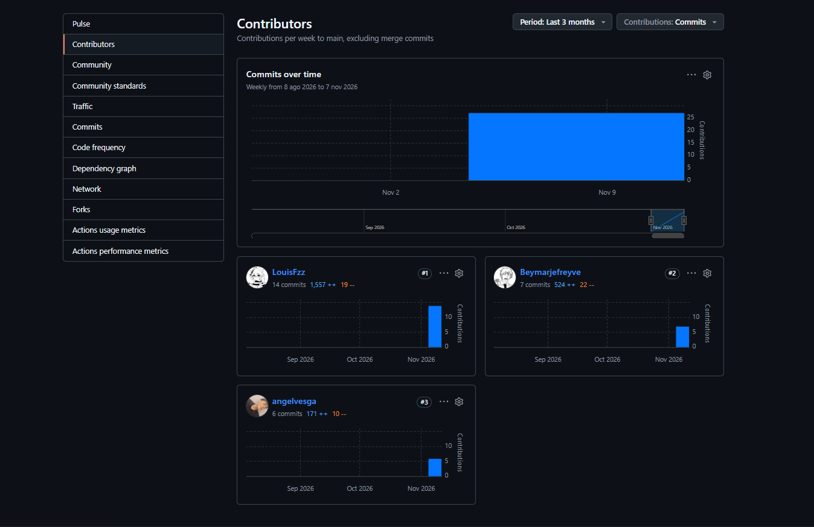

*0a: página Contributors del repositorio al terminar la práctica: LouisFzz con 14 commits, Beymarjefreyve con 7 y angelvesga con 6.*

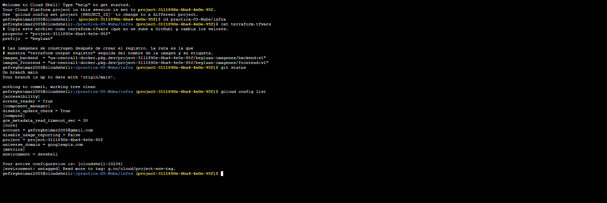

*0b: en Cloud Shell, el `terraform.tfvars` con el proyecto, el prefijo `beyluan` y las rutas de las imágenes; `git status` limpio; y `gcloud config list` con la cuenta `yefreybeimar2005@gmail.com` y el proyecto `project-3111890e-6ba4-4e0e-95f`.*

### Fase 1: registro, imágenes y la base

`terraform apply -target=google_artifact_registry_repository.registro` creó 7 recursos: las 6 APIs de la lista y el registro `beyluan-imagenes`. Las tres imágenes las construimos con `gcloud builds submit` en lugar de `docker build` y `docker push`, porque en la práctica 6 el push desde Cloud Shell falló con `connection refused` y Cloud Build fue lo que funcionó. Los builds fueron `5da51e3d` (backend, 36 s), `d4639b8a` (frontend, 20 s) y `eefe24fd` (cocina, 34 s), todos con `STATUS: SUCCESS`. En cada uno salió el aviso de que la cuenta de Cloud Build no tiene el rol Logs Writer; es informativo y no afectó las imágenes.

El `terraform apply` completo terminó así:

```
Apply complete! Resources: 8 added, 0 changed, 0 destroyed.

Outputs:

registro = "us-central1-docker.pkg.dev/project-3111890e-6ba4-4e0e-95f/beyluan-imagenes"
url_backend = "https://beyluan-backend-ivd2fmc7ia-uc.a.run.app"
url_frontend = "https://beyluan-frontend-ivd2fmc7ia-uc.a.run.app"
```

Desde el teléfono pedimos un tinto y un café con leche. El backend respondió de inmediato con el número 1, y el pedido se quedó en `recibido`. En los registros del backend quedó la advertencia:

```
WARNING:backend:TEMA está vacío: el pedido EUA6gyihP6VzFz7TEQIN se guardó pero nadie le avisa a la cocina
```

Después de esa línea se ve el `GET /pedidos/EUA6gyihP6VzFz7TEQIN` que hace la página cada 5 segundos para revisar el estado, siempre con la misma respuesta.

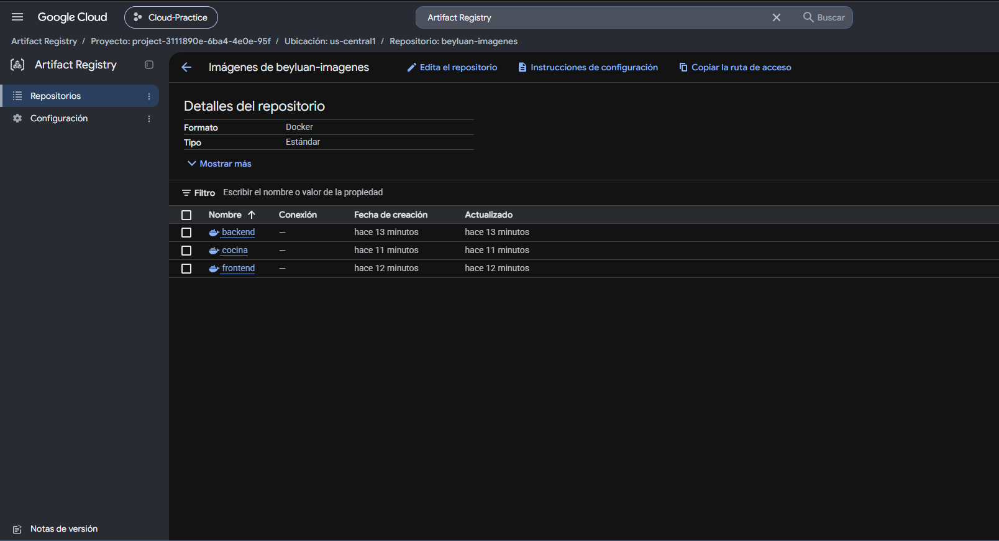

*1a: repositorio `beyluan-imagenes` con las imágenes `backend`, `cocina` y `frontend`.*

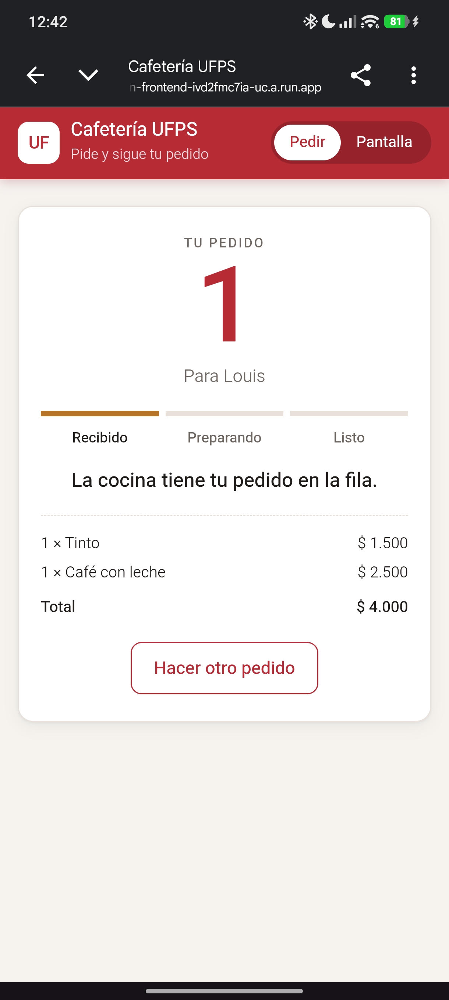

*1b: el pedido 1, para Louis, en `recibido`: "La cocina tiene tu pedido en la fila".*

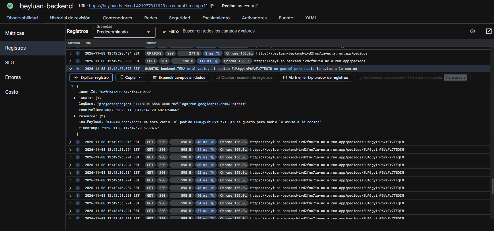

*1c: registros de `beyluan-backend` con el `POST /pedidos` en 201, la advertencia de `TEMA` vacío y las consultas de la página cada 5 segundos.*

### Fase 2: el tema

En `infra/pubsub.tf` creamos el tema `beyluan-pedidos` y le dimos a la cuenta del backend `roles/pubsub.publisher` sobre ese tema con `google_pubsub_topic_iam_member`, no sobre el proyecto. En `infra/main.tf` le pasamos al backend la variable `TEMA` con `google_pubsub_topic.pedidos.id`, que es la ruta completa que espera. El apply fue `2 added, 1 changed`: el tema, el permiso y el backend con la variable nueva.

Pedimos una empanada y un pastel de pollo (pedido 2). Siguió en `recibido`, pero ahora el registro del backend ya no tenía advertencia:

```
INFO:backend:Pedido ElOfnPBx9FFsFDRgyYYJ publicado en projects/project-3111890e-6ba4-4e0e-95f/topics/beyluan-pedidos
```

El mensaje llegó al tema, pero el tema no tenía suscripciones y lo descartó. En la consola, la pestaña Suscripciones de `beyluan-pedidos` decía "No hay suscripciones para mostrar".

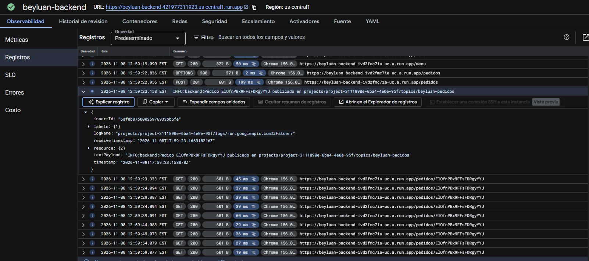

*2a: registro de `beyluan-backend` con el pedido `ElOfnPBx9FFsFDRgyYYJ` publicado en `beyluan-pedidos`.*

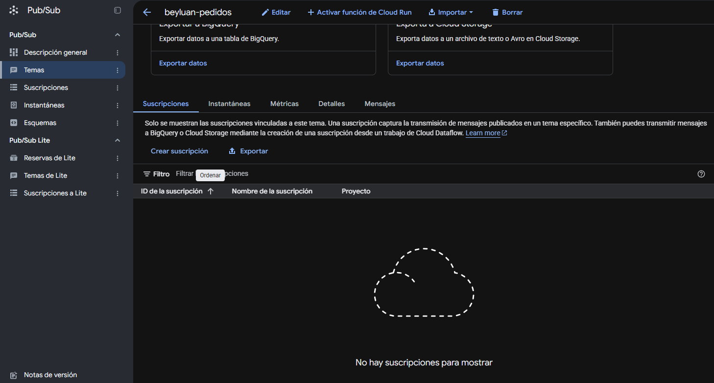

*2b: el tema `beyluan-pedidos` en la consola de Pub/Sub, sin ninguna suscripción.*

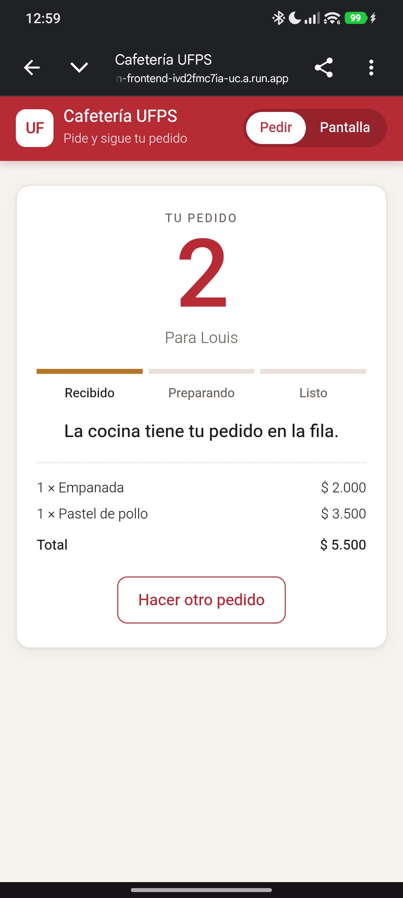

*2c: el pedido 2 sigue en `recibido` aunque el backend lo publicó.*

### Fase 3: la cocina privada

Agregamos la variable `imagen_cocina`, la salida `url_cocina` y, en `pubsub.tf`, la cuenta `beyluan-cocina` con `roles/datastore.user` (el mismo rol del backend), el servicio `beyluan-cocina` sin acceso público, la cuenta `beyluan-invocador` con `roles/run.invoker` sobre la cocina, el permiso `roles/iam.serviceAccountTokenCreator` del agente de Pub/Sub sobre la cuenta invocadora y la suscripción push `beyluan-cocina`. En la suscripción, `push_endpoint` y `audience` son la misma URL de la cocina, tomada de `google_cloud_run_v2_service.cocina.uri`. El correo del agente sale del bloque `data "google_project"`: `service-421977311923@gcp-sa-pubsub.iam.gserviceaccount.com`. El apply fue `7 added` y agregó la salida `url_cocina = "https://beyluan-cocina-ivd2fmc7ia-uc.a.run.app"`.

El pedido 4 (un café con leche y dos empanadas) pasó solo por `recibido`, `preparando` y `listo`. En los registros de la cocina, el pedido `M7V8zK1Ur1LSmBniWwVH` llegó a las 19:04:37 y quedó listo a las 19:04:43, 6,2 segundos después, que son los 6 de preparación. La solicitud de Pub/Sub (`APIs-Google`) aparece como `POST 204` con 6,251 s de latencia. El pedido 2 de la fase anterior siguió en `recibido`: su mensaje se perdió antes de que existiera la suscripción.

La suscripción quedó con tipo de envío push, autenticación con la cuenta `beyluan-invocador`, público igual a la URL de la cocina, plazo de confirmación de 60 segundos, reintentos de 10 a 60 segundos y retención de 7 días.

Para comprobar que la cocina es privada la llamamos sin token:

```
$ C=$(terraform output -raw url_cocina)
$ curl -i -X POST $C/
HTTP/2 403
date: Sun, 08 Nov 2026 19:23:49 GMT
content-type: text/html; charset=UTF-8
server: Google Frontend
content-length: 295

<html><head>
<meta http-equiv="content-type" content="text/html;charset=utf-8">
<title>403 Forbidden</title>
</head>
<body text=#000000 bgcolor=#ffffff>
<h1>Error: Forbidden</h1>
<h2>Your client does not have permission to get URL <code>/</code> from this server.</h2>
<h2></h2>
</body></html>
```

Ese 403 no aparece en los registros de texto de la cocina, porque Cloud Run lo rechaza antes de que llegue al código. Sí aparece en el registro de solicitudes `run.googleapis.com/requests`: `2026-11-08T19:23:49.360506Z  POST  403  curl/8.5.0`.

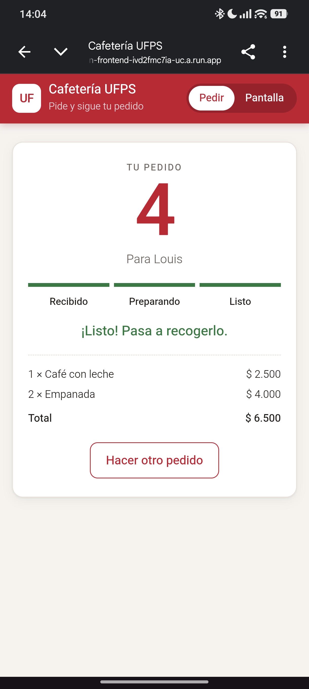

*3a: el pedido 4, para Louis, en `listo`: "¡Listo! Pasa a recogerlo".*

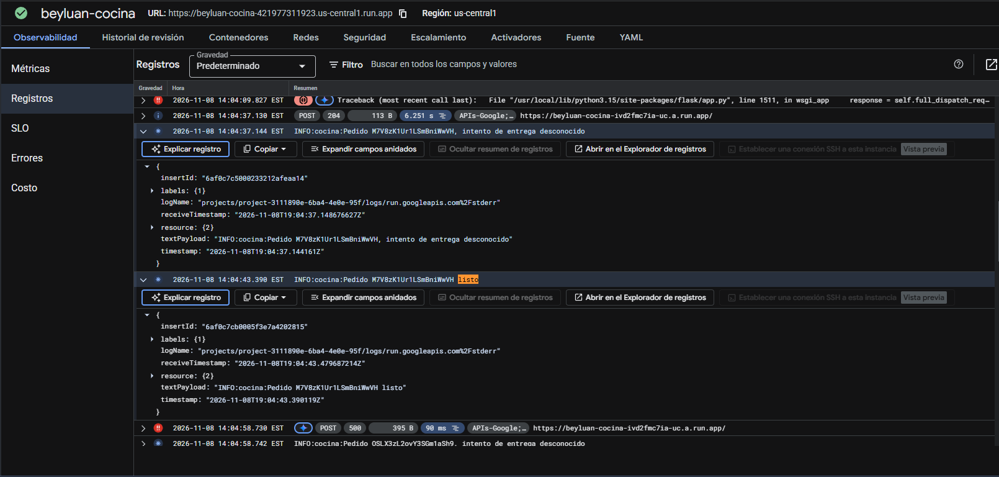

*3b: registros de `beyluan-cocina` con el `POST 204` de Pub/Sub de 6,251 s y las líneas del pedido `M7V8zK1Ur1LSmBniWwVH` recibido y listo.*

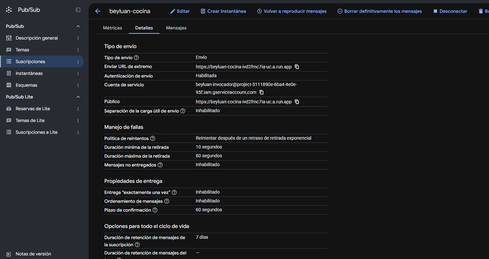

*3c: detalles de la suscripción `beyluan-cocina`: envío push, cuenta `beyluan-invocador`, plazo de 60 segundos y reintentos de 10 a 60 segundos.*

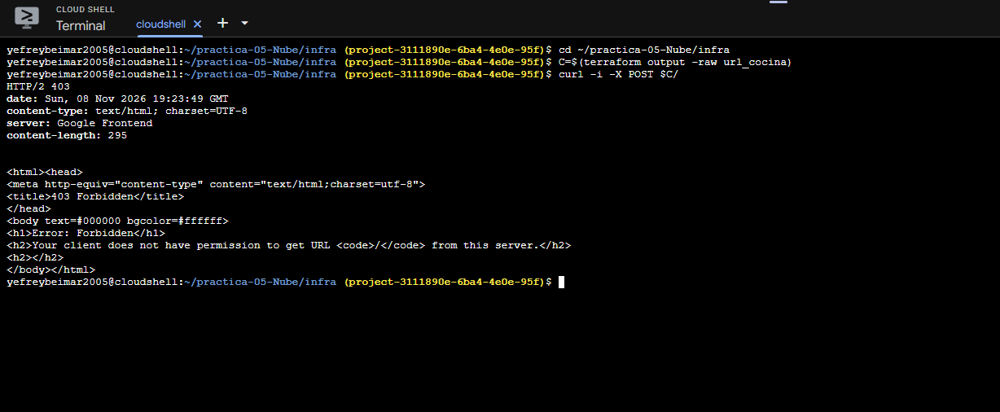

*3d: `curl -i -X POST` a la cocina sin token, con respuesta `HTTP/2 403`.*

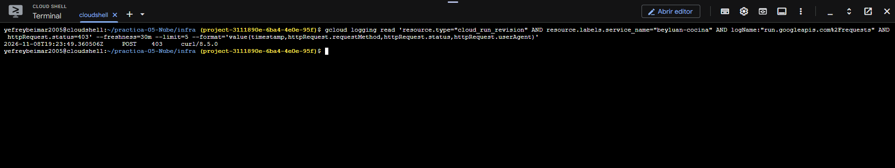

*3e: el mismo 403 en `run.googleapis.com/requests`, con `curl/8.5.0` como agente.*

### Fase 4: lo asíncrono, visto

Con la pestaña Pantalla abierta en el teléfono y el inventario repuesto (20 tintos), lanzamos los sesenta pedidos desde Cloud Shell:

```
$ time (seq 60 | xargs -P 20 -I{} curl -s -o /dev/null -w "%{http_code} " -X POST $B/pedidos ...)
201 201 201 ... (60 veces)
real    0m11.474s
```

El backend aceptó los 60 en 11,5 segundos, todos con `201`. La cocina se tomó su tiempo: unos segundos después la pantalla mostraba pedidos en las tres columnas, con varios en `recibido`, 9 o más en `preparando` y los primeros en `listo`.

Los números no salieron en orden. El pedido 64 (cliente "Ráfaga 47") seguía en `recibido` cuando el 57 ya estaba listo, y el número que recibió cada cliente tampoco coincide con su posición en la ráfaga, porque los 20 hilos de `xargs` llegan al backend en cualquier orden.

La pantalla solo muestra los últimos 20 pedidos (del 45 al 64), así que la cuenta completa la sacamos del inventario. El tinto terminó en **-5**: se descontaron 25 tintos, es decir, quedaron 25 pedidos listos y 35 rechazados, cuando solo había 20 tintos. La cocina revisaba si alcanzaba y descontaba en pasos separados, y con varios pedidos a la vez todos veían que alcanzaba antes de que alguno descontara. Después repusimos el inventario.

En las métricas de la suscripción, "Mensajes sin confirmar por región" subió a 2 hacia las 2:36 p. m. y volvió a 1. La gráfica toma un dato por minuto y la cocina vació la cola en menos de un minuto, por eso el pico se ve pequeño. El 1 que queda de fondo y la "Antigüedad del mensaje sin confirmar", que sube sin parar hasta 38 minutos, son del plato misterioso de la fase 3, que llevaba ese tiempo reintentándose. En Cloud Run, la cocina llegó a 3 instancias, el máximo que declaramos.

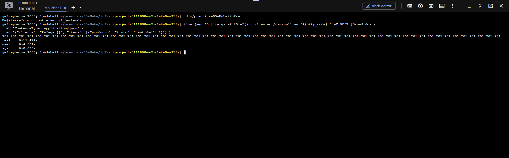

*4a: sesenta respuestas `201` en 11,474 segundos.*

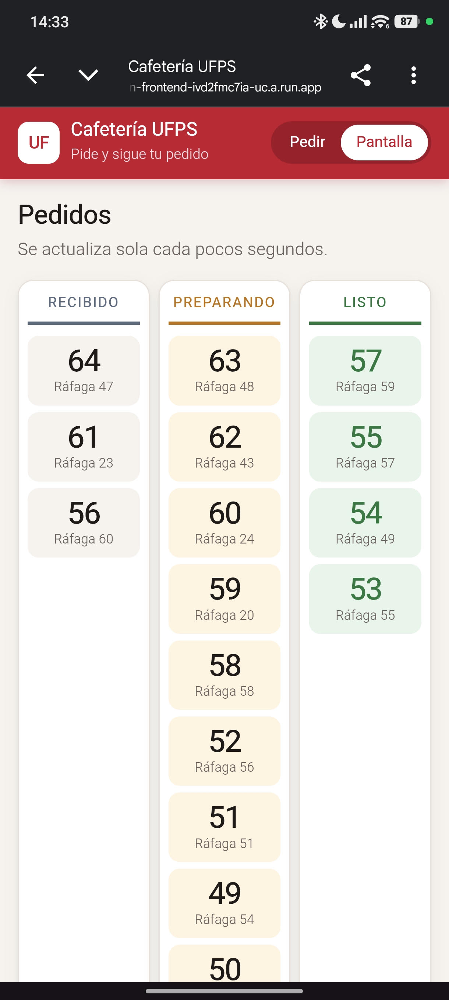

*4b1: la pantalla durante la ráfaga, con pedidos en `recibido`, `preparando` y `listo`.*

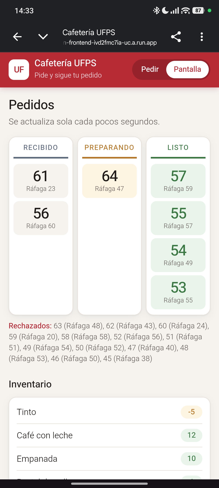

*4b2: la cola casi vacía, la lista de rechazados y el tinto ya en -5.*

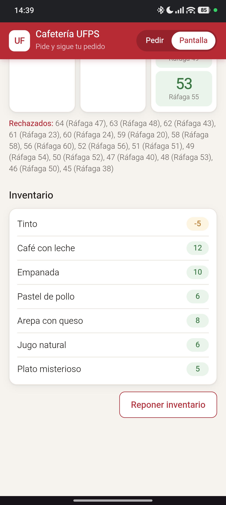

*4c: inventario con el tinto en -5.*

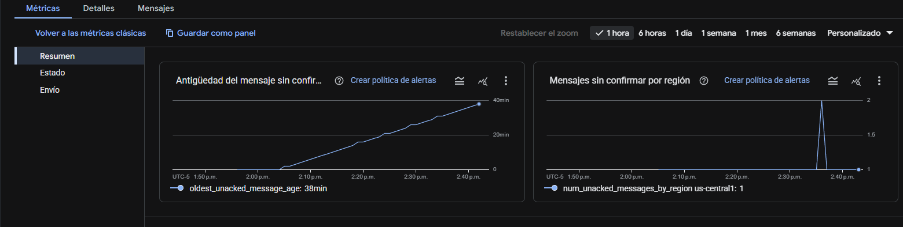

*4d: métricas de la suscripción `beyluan-cocina`: el pico de mensajes sin confirmar y la antigüedad del mensaje del plato misterioso.*

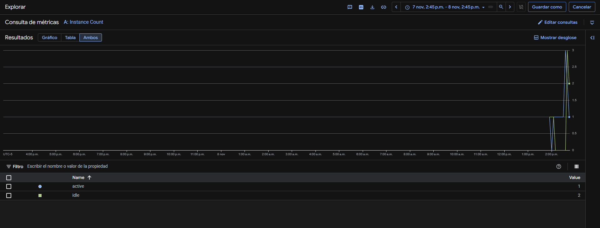

*4e: cantidad de instancias de `beyluan-cocina`, que llega a 3 durante la ráfaga.*

### Fase 5: una falla a propósito

Agregamos `PROBABILIDAD_FALLO = "0.5"` a la cocina (apply `1 changed`), repusimos el inventario e hicimos cuatro pedidos de un tinto. Si cada pedido descontara una vez, habrían quedado 16 tintos; quedaron **14**. Se descontaron 6 tintos por 4 pedidos.

La cocina tuvo la falla simulada en dos pedidos, `5wSPFtAN24ya9idmX7uf` y `nhJ8Ao5KJgj2PYjR0E2D`, y cada uno se procesó dos veces. La historia del segundo en los registros:

```
20:00:49  INFO:cocina:Pedido nhJ8Ao5KJgj2PYjR0E2D, intento de entrega desconocido
20:00:55  INFO:cocina:Pedido nhJ8Ao5KJgj2PYjR0E2D listo
20:00:55  WARNING:cocina:Falla simulada en el pedido nhJ8Ao5KJgj2PYjR0E2D: el trabajo quedó hecho pero no se confirma
20:01:07  INFO:cocina:Pedido nhJ8Ao5KJgj2PYjR0E2D, intento de entrega desconocido
20:01:13  INFO:cocina:Pedido nhJ8Ao5KJgj2PYjR0E2D listo
```

La cocina terminó el pedido y descontó, pero respondió 500. Pub/Sub no recibió la confirmación y 12 segundos después lo entregó otra vez, y la cocina descontó de nuevo. La cuenta es 4 pedidos más 2 entregas repetidas: 6 tintos, y 20 - 6 = 14. El intento sale como "desconocido" porque la suscripción todavía no tenía política de mensajes muertos. Al final quitamos el bloque de `PROBABILIDAD_FALLO` y aplicamos (`1 changed`).

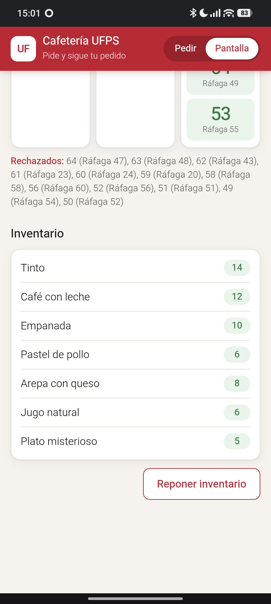

*5a: el tinto en 14 después de cuatro pedidos de un tinto.*

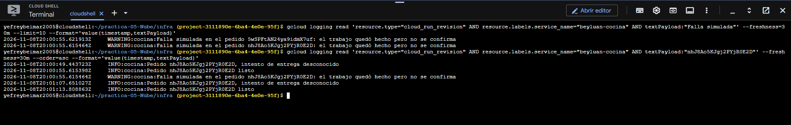

*5b: las dos fallas simuladas y la historia del pedido `nhJ8Ao5KJgj2PYjR0E2D`, listo dos veces.*

### Fase 6: el reto

Construimos la cocina idempotente como `cocina:v2` (build `4960a1f3`, 39 s) y cambiamos la etiqueta en `terraform.tfvars`. Ese apply, junto con los mensajes muertos, fue `4 added, 2 changed`: el tema y la suscripción de muertos, los dos permisos del agente, la cocina con la imagen nueva y la suscripción con su política de mensajes muertos.

#### Idempotencia con la falla al 0,5

Activamos la falla sin tocar el código, con `terraform apply -var probabilidad_fallo=0.5`, repusimos el inventario e hicimos diez pedidos de un tinto. Hubo cinco fallas simuladas y las cinco entregas repetidas se confirmaron sin descontar:

```
WARNING:cocina:Falla simulada en el pedido kMMQUXrEaOY121XSRZvt: el trabajo quedó hecho pero no se confirma
WARNING:cocina:Falla simulada en el pedido qcOiA1DJnZGX4P1T3ovi: el trabajo quedó hecho pero no se confirma
WARNING:cocina:Falla simulada en el pedido IrJLzdwELRulDXcbVu5M: el trabajo quedó hecho pero no se confirma
WARNING:cocina:Falla simulada en el pedido PCUxOLGMNfXz5RFIJG55: el trabajo quedó hecho pero no se confirma
WARNING:cocina:Falla simulada en el pedido L15f6ek1SWEbbuCfzis5: el trabajo quedó hecho pero no se confirma

INFO:cocina:Pedido kMMQUXrEaOY121XSRZvt ya estaba listo; se confirma sin prepararlo otra vez
INFO:cocina:Pedido L15f6ek1SWEbbuCfzis5 ya estaba listo; se confirma sin prepararlo otra vez
INFO:cocina:Pedido IrJLzdwELRulDXcbVu5M ya estaba listo; se confirma sin prepararlo otra vez
INFO:cocina:Pedido PCUxOLGMNfXz5RFIJG55 ya estaba listo; se confirma sin prepararlo otra vez
INFO:cocina:Pedido qcOiA1DJnZGX4P1T3ovi ya estaba listo; se confirma sin prepararlo otra vez
```

La cocina recibió 15 entregas para 10 pedidos y el tinto quedó exactamente en **10**. Con la cocina de la plantilla, 4 pedidos habían descontado 6. Después volvimos a dejar la falla en 0 con un `terraform apply` sin `-var`.

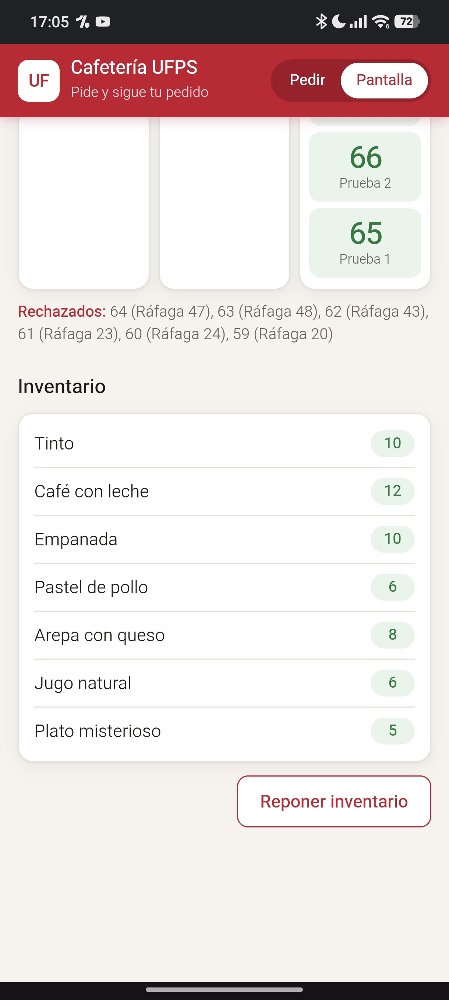

*6a: el tinto en 10 después de diez pedidos con la falla al 0,5.*

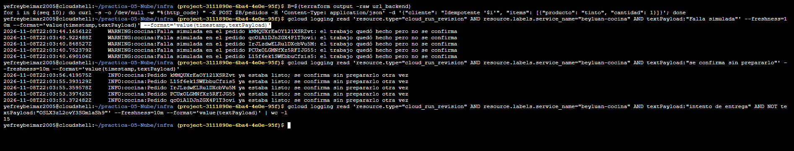

*6b: las cinco fallas simuladas, las cinco entregas repetidas confirmadas sin descontar y el conteo de 15 entregas.*

#### Mensajes muertos

Pedimos un plato misterioso (pedido `r9qCrouj2dwFlv3PnD4V`). Con la política de mensajes muertos, los registros ya muestran el número de intento:

| Intento | Hora (UTC) | Espera desde el anterior |
|---|---|---|
| 1 | 22:14:37 | |
| 2 | 22:14:50 | 13 s |
| 3 | 22:15:08 | 18 s |
| 4 | 22:15:27 | 19 s |
| 5 | 22:15:54 | 27 s |
| 6 | 22:16:25 | 31 s |
| 7 | 22:16:55 | 30 s |
| 8 | 22:17:36 | 41 s |
| 9 | 22:18:25 | 49 s |
| 10 | 22:19:12 | 47 s |

Después del décimo intento, 4 minutos y 35 segundos después del primero, Pub/Sub dejó de entregárselo a la cocina y lo pasó al tema de muertos. Lo leímos desde su suscripción:

```
$ gcloud pubsub subscriptions pull beyluan-muertos --limit=5
DATA: r9qCrouj2dwFlv3PnD4V
MESSAGE_ID: 23315282626313907
ATTRIBUTES: CloudPubSubDeadLetterSourceDeliveryCount=10
CloudPubSubDeadLetterSourceSubscription=beyluan-cocina
CloudPubSubDeadLetterSourceSubscriptionProject=project-3111890e-6ba4-4e0e-95f
CloudPubSubDeadLetterSourceTopicPublishTime=2026-11-08T22:14:36.582+00:00
```

El último error del plato misterioso en los registros de la cocina es el del intento 10, a las 22:19:12; después no llegó ninguna otra entrega de ese pedido.

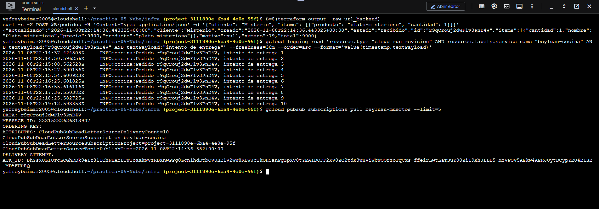

*6c: los diez intentos numerados del pedido `r9qCrouj2dwFlv3PnD4V` y el mensaje leído desde `beyluan-muertos`.*

#### Mediciones

Cada corrida repone el inventario, lanza 60 pedidos de un tinto con 20 hilos y espera a que todos terminen. El tiempo total va desde el primer pedido creado hasta el último terminado, con las marcas `creado` y `actualizado` que guarda Firestore.

Con 3 instancias de la cocina:

| Corrida | Llegada de la ráfaga | Último terminado | Trabajo de la cocina después del último pedido | Listos / rechazados |
|---|---|---|---|---|
| 1, backend en frío | 26,3 s | 32,4 s | 6,1 s | 20 / 40 |
| 2 | 16,1 s | 25,9 s | 9,8 s | 20 / 40 |
| 3 | 5,2 s | 27,1 s | 21,9 s | 20 / 40 |
| 4 | 5,2 s | 25,2 s | 20,0 s | 20 / 40 |
| 5 | 16,1 s | 26,9 s | 10,8 s | 20 / 40 |

Con 1 instancia (`terraform apply -var max_instancias_cocina=1`):

| Corrida | Llegada de la ráfaga | Último terminado | Trabajo de la cocina después del último pedido | Listos / rechazados |
|---|---|---|---|---|
| 1, revisión recién creada | 21,2 s | 63,6 s | 42,4 s | 20 / 40 |
| 2 | 16,2 s | 49,0 s | 32,8 s | 20 / 40 |
| 3 | 15,1 s | 49,1 s | 34,0 s | 20 / 40 |

Con 3 instancias el último pedido terminó en unos 26 segundos y con 1 instancia en unos 49. En las ocho corridas quedaron exactamente 20 pedidos listos, los mismos 20 tintos del inventario; en la ráfaga de la fase 4, con la cocina de la plantilla, habían quedado 25.

Lecturas y escrituras de Firestore de un pedido de un producto que queda listo:

| Quién | Qué hace | Lecturas | Escrituras |
|---|---|---|---|
| Backend | Incrementa el contador y guarda el pedido | 0 | 2 |
| Cocina | `marcar_preparando`: lee el pedido y lo pasa a `preparando` | 1 | 1 |
| Cocina | `terminar`: lee el pedido y el tinto, descuenta y lo marca `listo` | 2 | 2 |
| Total | | 3 | 5 |

Una entrega repetida de un pedido ya terminado cuesta 1 lectura y ninguna escritura. La cocina de la plantilla hacía 2 lecturas y 5 escrituras por pedido; la idempotencia cuesta una lectura más. Aparte quedan las lecturas de la página: una por cada consulta del teléfono al pedido y 20 por cada actualización de la pantalla.

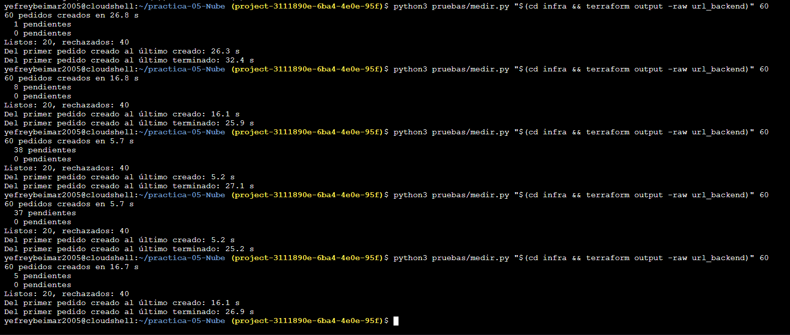

*6d: las cinco corridas con 3 instancias.*

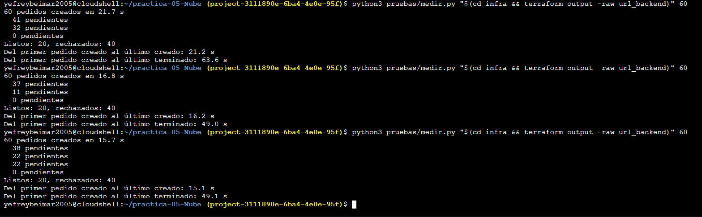

*6e: las tres corridas con 1 instancia.*

#### Reproducción desde cero

`terraform destroy` terminó con `Destroy complete! Resources: 28 destroyed.` y comprobamos que no quedaba nada: `terraform state list` no devolvió recursos y los listados de Cloud Run, temas, suscripciones, repositorios de Artifact Registry y bases de Firestore respondieron `Listed 0 items`. La salida del `destroy` la perdimos al limpiar la terminal, así que la evidencia muestra los borrados en los registros de auditoría del proyecto: la base, los dos temas, las suscripciones, los tres servicios y el registro de imágenes, entre las 22:54:44 y las 22:55:10.

Esperamos unos minutos para que Firestore liberara el nombre `beyluan-cafeteria` y repetimos el orden de la fase 1: el registro con `-target`, las tres imágenes con Cloud Build (`backend:v1`, `frontend:v1` y `cocina:v2`) y el resto. El último apply terminó con `Apply complete! Resources: 21 added, 0 changed, 0 destroyed.` y los mismos cuatro outputs de antes, porque todos los nombres salen del prefijo. No hicimos ningún paso a mano en la consola. El primer pedido después de recrear todo salió con el número 1, porque la base era nueva, y llegó a `listo`.

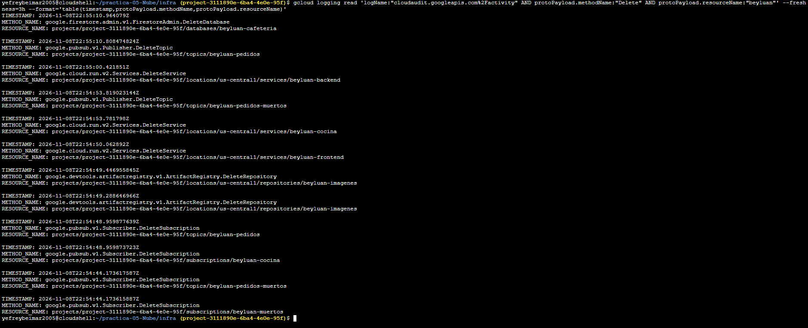

*6f: registros de auditoría con los `Delete` de la base, los temas, las suscripciones, los servicios y el registro durante el `terraform destroy`.*

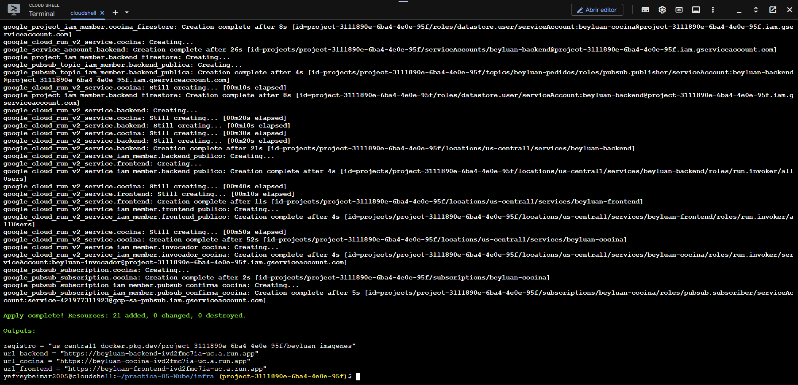

*6g: `Apply complete! Resources: 21 added` con los outputs `registro`, `url_backend`, `url_cocina` y `url_frontend`.*

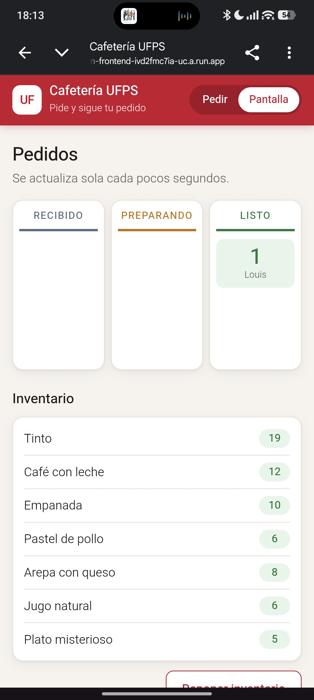

*6h1: la pantalla con el pedido 1 en `listo` y el tinto en 19.*

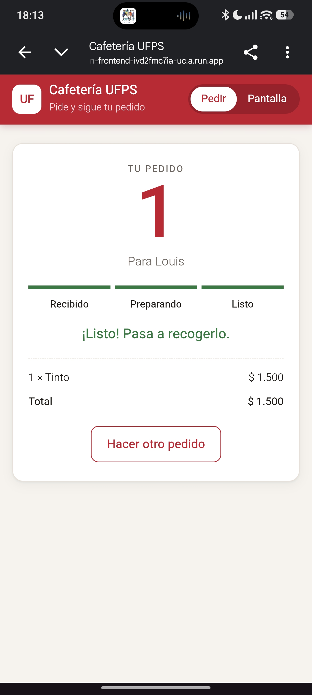

*6h2: el pedido 1, un tinto para Louis, en `listo`.*

### Incidencias y cómo se resolvieron

- En la fase 3 pedimos por error el plato misterioso. La cocina respondía 500 y Pub/Sub lo reintentó cada 50 segundos más o menos hasta que configuramos los mensajes muertos en el reto. Ese mensaje es el que aparece sin confirmar en las gráficas de la fase 4.
- En la primera sesión de Cloud Shell, `gcloud config list` mostró `account` vacío y `gcloud auth list` decía "No credentialed accounts". Cloud Shell usa sus propias credenciales, así que todo funcionó igual; en la siguiente sesión la cuenta ya aparecía.
- La primera versión del script de medición se cayó con `Temporary failure in name resolution`: abría una conexión por petición y el DNS de Cloud Shell no aguantó cientos de consultas a la vez. Con reintentos dejó de caerse, pero los pedidos llegaban tan despacio (36 a 43 segundos) que la cocina nunca hacía fila. Lo resolvimos con una conexión por hilo, reutilizada en todas sus peticiones.
- Después del `destroy`, el primer `terraform apply` falló con `dial tcp 142.251.107.95:443: connect: connection refused` hacia `cloudresourcemanager.googleapis.com`. Fue un problema de red de Cloud Shell; al repetir el apply funcionó.
- Perdimos la salida del `terraform destroy` al limpiar la terminal. La reemplazamos con los registros de auditoría del proyecto, que guardan cada borrado.

## Decisiones del reto

### 1. Cómo sabe la cocina que un pedido ya se preparó

La cocina consulta el campo `estado` del documento del pedido en Firestore. Si ya está en `listo` o `rechazado`, el pedido se terminó y no hay nada que hacer. No agregamos otra colección para llevar la cuenta de mensajes procesados: el pedido ya guarda ese dato, y su id es el mismo en todas las entregas de un mismo mensaje.

En `cocina/main.py` el trabajo quedó en dos transacciones:

- `marcar_preparando` lee el pedido y lo pasa a `preparando` solo si no está terminado. Si ya está terminado, `recibir()` responde `204` de una vez, sin esperar los 6 segundos y sin tocar el inventario.
- `terminar` lee el estado del pedido, lee las existencias y descuenta, todo dentro de la misma transacción. Si el pedido ya estaba terminado devuelve `repetido` y no escribe nada. Antes, la cocina descontaba con `firestore.Increment` en un lote aparte de la revisión; ahora el descuento sale de las existencias leídas en la transacción.

La solución aguanta dos entregas simultáneas del mismo pedido en dos instancias porque Firestore no deja que dos transacciones terminen sobre los mismos documentos con lecturas viejas. Si las dos leen el pedido en `preparando`, solo una puede confirmar; la otra se repite, vuelve a leer, encuentra el pedido en `listo` y devuelve `repetido` sin descontar. Subimos los reintentos de la transacción de 5 a 15 (`max_attempts=15`) porque en una ráfaga muchos pedidos compiten por el mismo documento del tinto.

No logramos provocar a mano dos entregas del mismo pedido en el mismo instante, pero el mismo mecanismo quedó probado de dos formas. Con la falla al 0,5, diez pedidos recibieron 15 entregas y el tinto bajó exactamente 10. En las ocho corridas de medición, hasta 24 pedidos a la vez peleaban por el documento del tinto y siempre quedaron 20 listos con 20 tintos; con la cocina de la plantilla habían quedado 25 y el tinto en -5.

### 2. Cuántos intentos antes de rendirse

Elegimos 10 intentos (`max_delivery_attempts = 10`); Pub/Sub admite desde 5. Con la política de reintentos de 10 a 60 segundos, medimos que los 10 intentos del plato misterioso tardaron 4 minutos y 35 segundos. Con 5 intentos, Pub/Sub se habría rendido a los 77 segundos, que fue el tiempo entre el primer intento y el quinto.

Un problema pasajero que vimos en esta práctica fue la propagación de permisos nuevos, que tarda uno o dos minutos; también están los arranques en frío de la cocina y los choques de transacciones en una ráfaga. Con 77 segundos un pedido podía terminar en muertos solo por un permiso que todavía no había hecho efecto, y con 4 minutos y medio tiene margen para recuperarse. Si el problema se arregla antes del intento 10, el pedido se prepara normalmente, y como la cocina es idempotente, los intentos anteriores no descuentan de más. Si no se arregla, el mensaje va a `beyluan-pedidos-muertos` y el pedido se queda en `preparando` en la pantalla. El id queda guardado en `beyluan-muertos` hasta 7 días, y cuando la causa esté resuelta se puede volver a publicar en `beyluan-pedidos`.

### 3. Los permisos de los mensajes muertos

Quien mueve un mensaje muerto no es la cocina sino el agente de Pub/Sub, `service-421977311923@gcp-sa-pubsub.iam.gserviceaccount.com`. Por eso los dos permisos son para él y cada uno se da sobre un recurso concreto:

- `roles/pubsub.publisher` sobre el tema `beyluan-pedidos-muertos`, para publicar en él el mensaje que se rindió. Sin este permiso, el agente no podría reenviar el mensaje y este seguiría reintentándose en la suscripción de la cocina.
- `roles/pubsub.subscriber` sobre la suscripción `beyluan-cocina`, para confirmar el mensaje en la suscripción original después de pasarlo al tema de muertos. Sin este permiso, el mensaje no saldría de la suscripción de la cocina.

Si faltara la suscripción `beyluan-muertos`, el mensaje muerto se perdería. Es lo mismo que pasó en la fase 2: un tema no guarda mensajes, solo reparte copias a sus suscripciones, y si no tiene ninguna, el mensaje se descarta. Con la suscripción, el plato misterioso quedó guardado y lo pudimos leer con `gcloud pubsub subscriptions pull beyluan-muertos`.

### 4. Cómo medimos

Usamos el script `pruebas/medir.py`, que corrimos desde Cloud Shell con:

```bash
python3 pruebas/medir.py "$(cd infra && terraform output -raw url_backend)" 60
```

El script repone el inventario con `POST /inventario/reiniciar`, lanza los 60 pedidos de un tinto con 20 hilos y consulta cada 3 segundos el estado de todos hasta que ninguno quede pendiente. El tiempo lo calcula con las marcas `creado` y `actualizado` que guarda Firestore en cada pedido, no con la hora de Cloud Shell, para que la consulta cada 3 segundos no afecte el resultado. Para cambiar el máximo de instancias sin editar el código agregamos la variable `max_instancias_cocina` y aplicamos con `-var max_instancias_cocina=1`. Hicimos 5 corridas con 3 instancias y 3 con 1; los resultados están en la tabla de la fase 6.

Con 1 instancia, el tiempo lo limitó la cocina: prepara 8 pedidos a la vez y cada uno tarda unos 6,2 segundos, así que 60 pedidos son 8 tandas, unos 50 segundos, y medimos 49. Con 3 instancias caben 24 pedidos a la vez: son 3 tandas, unos 19 segundos, más los 5 segundos que tarda en llegar la ráfaga, y medimos entre 25 y 27. Ahí pesó también la llegada de los pedidos: en las corridas donde la ráfaga tardó 16 segundos en llegar, el tiempo total fue casi igual, porque la cocina iba preparando a medida que llegaban. La primera corrida de cada serie fue la más lenta por los arranques en frío: del backend en la serie de 3 instancias (26 segundos para recibir los pedidos) y de la revisión nueva de la cocina en la serie de 1 instancia (63,6 segundos).

## Preguntas

### ¿Por qué el pedido de la fase 2 nunca se preparó, aunque después crearon la suscripción?

Porque un tema de Pub/Sub no guarda mensajes: le entrega una copia a cada suscripción que existe en el momento de publicar. El pedido `ElOfnPBx9FFsFDRgyYYJ` se publicó en `beyluan-pedidos` cuando el tema todavía no tenía suscripciones, así que el mensaje se descartó en ese momento. La suscripción `beyluan-cocina` que creamos en la fase 3 solo recibe los mensajes publicados después de existir. El backend publica una sola vez, dentro de `POST /pedidos`, y nada en el sistema vuelve a publicar los pedidos que se quedan en `recibido`. Por eso ese pedido siguió en `recibido` mientras la cocina preparaba todos los demás. Para prepararlo habría que publicar otra vez su id a mano en el tema.

### Si quitan el run.invoker de la cuenta invocadora, ¿qué deja de funcionar, cuánto tarda en notarse, qué ve el cliente en el teléfono y dónde encontrarían el error?

Deja de funcionar solo la entrega de los pedidos a la cocina. El backend sigue guardando y publicando, y el agente de Pub/Sub sigue firmando tokens a nombre de `beyluan-invocador`, pero Cloud Run rechaza cada entrega con 403 antes de que llegue al código de la cocina, como pasó con nuestro `curl` sin token. Se nota cuando el cambio de IAM se propaga, normalmente en uno o dos minutos; desde ahí todas las entregas fallan. Pub/Sub reintenta con esperas de 10 a 60 segundos, y con nuestra política, a los 10 intentos (unos 4 minutos y medio) manda el mensaje a `beyluan-pedidos-muertos`. En el teléfono el cliente recibe su número sin ningún error, porque el backend responde 201, pero el pedido se queda en `recibido` para siempre: la cocina nunca llega a ejecutarse y no lo marca como `preparando`. El error no aparece en los registros de texto de la cocina ni en los del backend, que sigue diciendo que publicó. Se encuentra en el registro de solicitudes `run.googleapis.com/requests` de `beyluan-cocina`, como `POST 403` con agente `APIs-Google`; en las métricas de la suscripción, donde suben los mensajes sin confirmar y la antigüedad del más viejo; y en los mensajes que se acumulan en `beyluan-muertos`.

### Con PROBABILIDAD_FALLO en 0.5, ¿cuántas veces le llega en promedio un mismo pedido a la cocina, con la cocina de la plantilla y con su cocina idempotente?

Con la cocina de la plantilla, en promedio 2 veces. La falla ocurre después de hacer el trabajo, y cada entrega repetida vuelve a hacer todo, incluida la falla con probabilidad 0,5. El número de entregas hasta que una responde 2xx es geométrico, con promedio 1 / (1 - 0,5) = 2, y cada entrega descuenta inventario. Con la cocina idempotente, en promedio 1,5 veces. La primera entrega falla con probabilidad 0,5, pero la segunda encuentra el pedido en `listo` dentro de `marcar_preparando` y responde 204 antes de llegar al punto de la falla, así que nunca hay una tercera: 1 + 0,5 = 1,5. Los dos números son distintos porque en la plantilla la entrega repetida puede volver a fallar, y en la idempotente no. En nuestras pruebas, con la plantilla fueron 6 entregas para 4 pedidos (1,5): con solo 4 pedidos las dos repeticiones acertaron a la primera, y por eso salió por debajo de 2. Aun así, esas 6 entregas descontaron 6 tintos. Con la cocina idempotente fueron 15 entregas para 10 pedidos, exactamente 1,5, y se descontaron solo 10 tintos.
